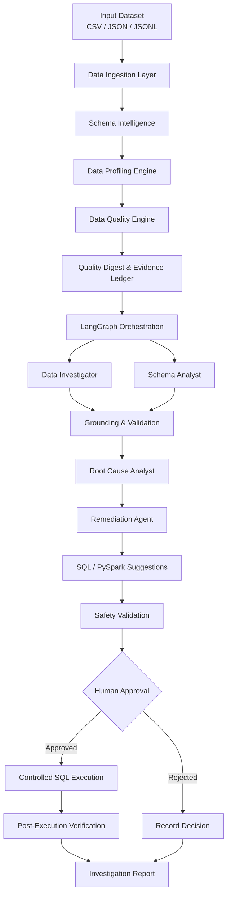

# DataSentinel AI

### Agentic AI for Data Quality, Root-Cause Analysis & Pipeline Observability

**Turn data quality issues into explainable investigations and safely validated remediation.**

DataSentinel AI is an intelligent data observability platform that combines deterministic data engineering with multi-agent AI to profile datasets, detect quality issues, investigate root causes, and recommend SQL/PySpark remediation through a human-in-the-loop workflow.

Instead of simply reporting that a dataset is broken, DataSentinel aims to explain **what went wrong, why it happened, and how it can be fixed safely.**

---

## Overview

Modern data pipelines process large volumes of information, but maintaining data quality remains a challenge. Missing values, duplicate records, schema changes, invalid formats and anomalous values can silently affect downstream analytics.

Traditional data quality tools identify problems. DataSentinel AI takes the investigation further.

It combines a deterministic data quality engine with a LangGraph-powered multi-agent investigation system to transform data quality findings into actionable insights.

### What makes DataSentinel different?

- **Deterministic first:** Data profiling, quality checks and scoring are computed by Python-based engineering logic, not guessed by an LLM.
- **Agentic investigation:** Specialized AI agents investigate data issues and identify potential root causes.
- **Evidence-grounded reasoning:** Agent findings are checked against an evidence ledger.
- **Safe remediation:** SQL recommendations are validated before execution.
- **Human oversight:** Proposed fixes require explicit approval.
- **Traceability:** Investigation runs, execution events and remediation artifacts are recorded.

---

## Core Features

| Capability               | Description                                                                           |
| ------------------------ | ------------------------------------------------------------------------------------- |
| Data Ingestion           | Load CSV, JSON and JSONL datasets                                                     |
| Schema Intelligence      | Infer data types, identify potential keys and generate schema contracts               |
| Data Profiling           | Analyze distributions, nulls, duplicates, cardinality and statistical characteristics |
| Data Quality Engine      | Detect missing values, duplicates, invalid types, invalid dates and outliers          |
| Quality Scoring          | Calculate explainable quality scores and dimension-level assessments                  |
| Schema Drift Detection   | Compare incoming schemas against established baselines                                |
| AI Investigation         | Use specialized agents to investigate quality findings                                |
| Root-Cause Analysis      | Generate evidence-supported explanations of data issues                               |
| Remediation Intelligence | Propose SQL and PySpark remediation strategies                                        |
| SQL Validation           | Validate SQL against safety policies before execution                                 |
| Human Approval           | Require explicit approval before executing proposed fixes                             |
| Execution Verification   | Re-evaluate data quality after remediation                                            |
| Audit Logging            | Track investigation and remediation events                                            |

---

## System Architecture

DataSentinel follows a layered architecture that separates deterministic data engineering from AI orchestration.



### Architectural Principle

The platform maintains a strict separation of responsibilities:

**Deterministic Engine**

- Calculates quality scores.
- Detects data quality violations.
- Generates evidence.
- Validates SQL safety.
- Verifies remediation results.

**AI Agent Layer**

- Interprets deterministic findings.
- Investigates possible root causes.
- Analyzes schema-related issues.
- Recommends remediation strategies.
- Produces structured investigation reports.

The LLM does not determine actual quality scores or independently establish whether a remediation succeeded.

---

## Multi-Agent Investigation Workflow

DataSentinel uses LangGraph to orchestrate specialized agents through a controlled investigation workflow.

| Agent              | Responsibility                                                 |
| ------------------ | -------------------------------------------------------------- |
| Data Investigator  | Investigates data quality violations and their characteristics |
| Schema Analyst     | Examines schema inconsistencies and drift                      |
| Root Cause Analyst | Correlates findings and investigates potential causes          |
| Remediation Agent  | Proposes corrective SQL/PySpark strategies                     |

### Investigation Lifecycle

1. **Prepare Context** — Collect dataset metadata, quality findings and evidence.
2. **Investigate** — Analyze data quality issues and schema changes.
3. **Ground Findings** — Validate agent claims against available evidence.
4. **Identify Root Causes** — Correlate findings and determine likely causes.
5. **Generate Remediation** — Propose corrective actions.
6. **Validate Fixes** — Apply safety and policy checks.
7. **Request Approval** — Pause execution for human review.
8. **Execute Approved Fixes** — Execute permitted SQL remediation in a controlled environment.
9. **Verify Results** — Recalculate quality metrics and record outcomes.
10. **Generate Report** — Produce an investigation summary with traceable findings.

The workflow also supports checkpoints, retries, interruption and resumption.

---

## Safety & Reliability

AI-generated remediation must never be treated as automatically trustworthy.

DataSentinel incorporates multiple safety mechanisms:

- Evidence-ID validation to prevent unsupported claims from being treated as confirmed findings.
- Engine-controlled severity levels.
- SQL policy validation and DuckDB sandboxing.
- Protection against unsafe SQL operations and unauthorized file access.
- Static safety analysis of generated PySpark code.
- Explicit human approval before remediation execution.
- Source-data integrity verification.
- Approval binding to the validated remediation content.
- Execution audit events and artifact tracking.
- Post-execution quality verification.

**Important:** Generated PySpark suggestions are statically inspected and are not executed by the platform.

---

## Technology Stack

| Layer                | Technologies         |
| -------------------- | -------------------- |
| Programming Language | Python               |
| Data Processing      | Pandas, PySpark      |
| AI Framework         | LangChain            |
| Agent Orchestration  | LangGraph            |
| LLM Provider         | Groq                 |
| SQL Execution        | DuckDB               |
| Frontend             | Streamlit            |
| Validation           | Pydantic             |
| Persistence          | SQLite               |
| Visualization        | Plotly               |
| Testing              | Pytest               |
| Development          | VS Code, Git, GitHub |

---

## Project Structure

```text
datasentinel-ai/
│
├── app/
│   ├── components/
│   ├── sections/
│   └── streamlit_app.py
│
├── datasentinel/
│   ├── ingestion/
│   ├── schema/
│   ├── profiling/
│   ├── quality/
│   ├── investigation/
│   ├── remediation/
│   ├── config.py
│   └── pipeline.py
│
├── datasentinel_agents/
│   ├── nodes/
│   ├── runtime/
│   ├── tools/
│   ├── service.py
│   ├── grounding.py
│   └── models.py
│
├── sample_data/
├── scripts/
├── docs/
├── tests/
│
├── .env.example
├── .gitignore
├── CONTRIBUTING.md
├── pyproject.toml
├── requirements-lock.txt
├── requirements.txt
└── README.md
```

---

## Getting Started

### Prerequisites

- Python 3.12 recommended
- Git
- A Groq API key for live AI investigations

### 1. Clone the repository

```bash
git clone https://github.com/Sinon1310/datasentinel-ai.git

cd datasentinel-ai
```

### 2. Create a virtual environment

```bash
python3.12 -m venv .venv

source .venv/bin/activate
```

### 3. Install dependencies

```bash
python -m pip install --upgrade pip

pip install -r requirements-lock.txt
```

### 4. Configure environment variables

```bash
cp .env.example .env
```

Add your Groq API key and desired model configuration to `.env`, following the variable names in `.env.example`.

Never commit your `.env` file or expose API credentials.

### 5. Launch the application

```bash
streamlit run app/streamlit_app.py
```

Open the local Streamlit URL displayed in your terminal.

---

## Running Tests

DataSentinel includes automated tests for its data engineering engine, agent workflow, safety controls and application behavior.

Run the complete offline test suite:

```bash
pytest -q
```

Run the live Groq integration test separately:

```bash
python -c "from dotenv import load_dotenv; load_dotenv(override=True); import pytest; raise SystemExit(pytest.main(['-m', 'live', '-v']))"
```

The live test requires a valid API key and available provider quota.

**Testing philosophy:** Core application behavior and agent workflow logic should be testable offline using deterministic mock responses. Live LLM calls are reserved for integration validation.

---

## Engineering Philosophy

DataSentinel AI is built around one central principle:

> **AI should make data engineering more intelligent, not less accountable.**

By combining deterministic data processing, evidence-grounded reasoning, controlled execution and human oversight, the platform explores how agentic AI can improve the reliability and maintainability of modern data pipelines.

---

## Author

**Sinon Rodrigues**

- GitHub: [@Sinon1310](https://github.com/Sinon1310)

---

*Built with Python, LangGraph and a focus on trustworthy AI-powered data engineering.*
